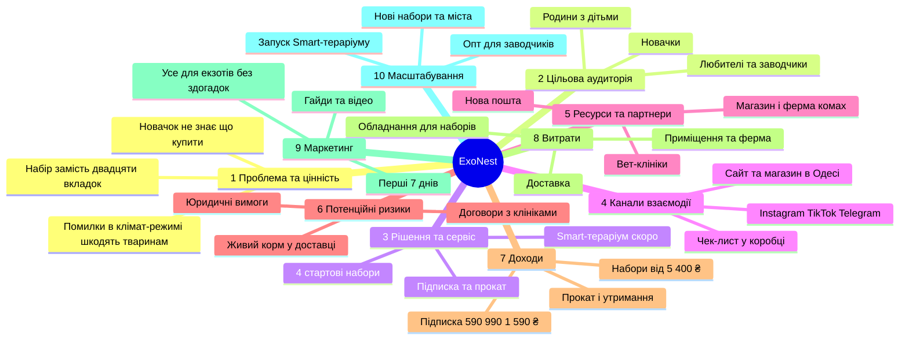

# ExoNest: ментальна карта проєкту

> Усе для екзотів без здогадок. Магазин і сервіс для власників рептилій та дрібних екзотичних ссавців (Одеса).
> Сайт проєкту: <https://exonest-site.vercel.app/>

Карта складена за десятьма питаннями Service Jam. Усе, що взято зі сторінок сайту, подано як є. Пункти з позначкою _(ідея)_ є пропозиціями, яких на сайті ще немає.

## Карта

## Деталі за блоками

<table>
<tr>
<td valign="top" width="50%">

### 1. Проблема та цінність

**Яку потребу вирішуємо.** Новачок із рептилією чи дрібним ссавцем не знає, що купити й як налаштувати. Гроші йдуть на зайве обладнання, а відповіді розкидані по різних джерелах.

**Чому зараз.** Більшість проблем зі здоров’ям рептилій пов’язані з температурою й вологістю. Тварин часто купують імпульсно, ще до того, як удома все готово.

**Якщо не вирішувати.** Хворі або загиблі тварини, витрачені гроші, розчарування власника.

**Унікальна цінність.** Готовий набір із сумісних елементів, друкований чек-лист, підтримка в месенджері, корм власного розведення й чесні поради без зайвих покупок.

### 2. Цільова аудиторія

**Основний клієнт.** Новачок, який вибирає першу тварину: геккона, змію, шиншилу чи їжака. Спершу читає й порівнює, потім купує. Одеса й уся Україна через Нову пошту.

**Додаткові клієнти.** Любителі (обладнання, добавки), заводчики (підписка на комах, гуртові умови), родини з дітьми.

**Яку роботу виконують.** Функціональну: правильно облаштувати дім тварині. Емоційну: спокій, що все зроблено правильно. Соціальну: бути відповідальним власником.

**Стейкхолдери.** Вет-клініки, постачальники обладнання, Нова пошта, заводчики з документами про походження, команда проєкту, діти й родини клієнтів.

### 3. Рішення та сервіс

**Який сервіс.** Магазин і сервіс: 4 стартові набори (5 400–7 800 ₴), каталог, 6 гайдів, підписка, прокат, вет-партнери, Smart-тераріум (скоро).

**Основний сценарій.** Гайд або чек-лист → вибір набору → доставка чи самовивіз → налаштування з консультацією → щомісячна коробка → вет-партнер за потреби.

**Чим краще за інших.** Усе сумісне й перевірене в магазині, є друкований чек-лист, тварин не продають з вітрини, корм вирощують самі.

**Швидкий MVP.** Сайт, набори й гайди вже є. Для тесту вистачить Telegram-чату підтримки та листа очікування для Smart-тераріуму. Прототип на ESP32 тестується в магазині.

### 4. Канали взаємодії

**Де дізнається.** Instagram, TikTok, Telegram, пошук (через гайди), магазин в Одесі, місячна розсилка.

**Як користується.** Сайт (каталог, кошик, акаунт), чат у Telegram, доставка Новою поштою або самовивіз.

**Ключові точки контакту.** Гайд → сторінка набору → кошик → чек-лист у коробці → консультація в Telegram → місячна коробка → лист раз на місяць.

### 5. Ресурси та партнери

**Що потрібно.** Люди: консультант і той, хто збирає набори та доглядає ферму. Технології: сайт, ESP32, Telegram-бот. Простір: магазин із тераріумами й ферма комах.

**Що вже є.** Сайт, 4 набори, 6 гайдів, магазин в Одесі, прототип контролера.

**Чого не вистачає.** Підписаних договорів з клініками: на сайті поки плейсхолдери, дані додадуть після підписання.

**Партнери.** Вет-клініки в Києві, Львові, Харкові й Одесі, Нова пошта, заводчики з документами про походження.

**Постачальники обладнання** _(ідея)_. Виробники тераріумів, вольєрів і обігрівачів із правом повернення або закупівлею під замовлення.

</td>
<td valign="top" width="50%">

### 6. Потенційні ризики

**Що може зупинити запуск.** Договори з клініками ще не підписані. Живий корм залежить від погоди й вихідних. Є вимоги до продажу тварин і документів про походження.

**Ризики досвіду.** Комахи прибули неживими (заміна за фото протягом 2 годин). Набір не підійшов. Складно вибрати серед багатьох товарів.

**Обмеження.** Час (навчальний проєкт), бюджет на обладнання й запас, юридичні вимоги до продажу тварин і повернень.

**Безпека пристрою** _(ідея)_. Smart-тераріум працює від 230 В і керує обігрівом. Потрібні тести й аварійне вимкнення перегріву до продажу.

### 7. Доходи

**За що платять.** Набори, підписка (590, 990, 1 590 ₴ на місяць), обладнання й корм, прокат (від 150 ₴ за тиждень), тимчасове утримання (від 120 ₴ за добу).

**Найпростіша модель.** Разова покупка набору плюс підписка на корм і витратні матеріали.

**Що можна тестувати.** Три плани підписки, прокат із зарахуванням у покупку, передзамовлення Smart-тераріуму, безкоштовну доставку від 2 000 ₴.

### 8. Витрати

**Що найдорожче.** Обладнання для наборів (тераріуми, вольєри, обігрівачі), приміщення магазину, ферма комах, доставка.

**Що оптимізувати.** Вет-послуги через партнерів, гайди пишуться один раз, самовивіз скорочує доставку.

**Старт за 48 годин** _(ідея)_. Один доступний набір («Перший геккон», 5 400 ₴), Telegram як підтримка, замовлення через форму контактів, лист очікування.

### 9. Маркетинг і просування

**Меседж.** «Усе для екзотів без здогадок», «Один набір замість двадцяти вкладок», «Спершу прочитати, потім купувати».

**Найдешевший канал** _(ідея)_. Гайди для пошуку й короткі відео з тераріумів магазину в TikTok та Instagram.

**Перші 7 днів** _(ідея)_. Дні 1–2: відео з тераріумом. Дні 3–4: пости в місцевих спільнотах власників екзотів. Дні 5–6: розсилка з чек-листом. День 7: запрошення до магазину в Одесі.

### 10. Масштабування та розвиток

**Smart-тераріум.** Лист очікування, передзамовлення, перша невелика партія.

**Ширший асортимент.** Нові набори для інших видів, більше обладнання в каталозі, тварини з документами після чек-листу умов.

**Мережа й опт.** Більше вет-партнерів, гуртові поставки комах і субстрату для заводчиків.

**Далі** _(ідея)_. Telegram-бот з нагадуваннями про догляд, інші міста.

</td>
</tr>
</table>

---

Проєкт навчальний і некомерційний. Дані клінік-партнерів на сайті поки є плейсхолдерами.
